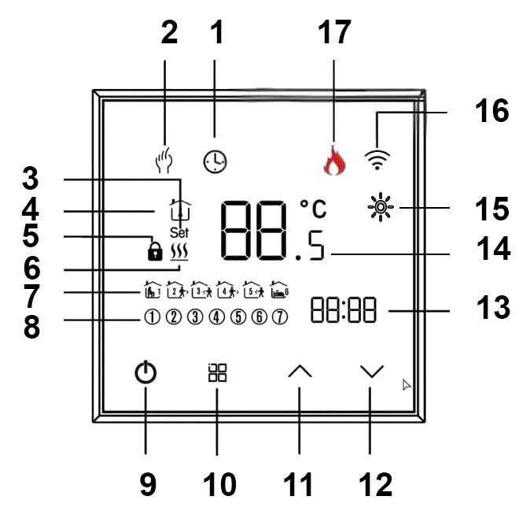

# tuya_thermostat_full_custom_r0b_zrd или Open Source Thermostat (OS Thermostat)

**Автор не несет никакой ответственности, если вы, воспользовавшись этим проектом, 
превратите свой умный термостат в полоумный. А также за возможный ущерб при 
эксплуатации этого термостата.**

> [!WARNING]
> Внимание!!! В написании кода и документации для термостата активно принимал участие [**OpenCode**](https://opencode.ai/).

## [Get started](doc/getting_started.md)

## Руководство пользователя Zigbee OS Thermostat.

Термостат состоит из двух микроконтроллеров: основного **CA51F253L2**, который непосредственно управляет экраном, 
клавишами и реле нагрева, и Zigbee-модуля **ZT3L** (**Telink TLSR8258**), который общается с сетью.

Возможности:

- измерение температуры внутренним и внешним датчиками (два NTC);
- управление нагревом с гистерезисом и выбором датчика (IN / OU / AL);
- управление нагревом от внешнего беспроводного датчика температуры **Zigbee** (WS);
- недельное расписание: 7 дней × 6 переходов;
- меню настроек из 10 пунктов, калибровка датчиков, лимиты заданной температуры;
- установка часов, синхронизация из сети;
- блокировка клавиш, индикация состояния, дневная/ночная яркость;
- обновление прошивок обоих MCU (**CA51F253L2** и **ZT3L**) по воздуху (через Zigbee-хаб).

---

## 1. Дисплей

### Обычный режим (термостат включён)

Номера в таблице соответствуют указателям на рисунке выше.

| № | Название | Описание |
|---|----------|----------|
| 1 | **"Нагрев"** | символ отображается, когда идёт нагрев (реле включено) |
| 2 | **"Солнце"** | отображается пока беспроводной датчик WS жив |
| 3 | **"День недели"** | текущий день недели (в меню — редактируемый день) |
| 4 | **"Слот расписания"** | слоты недельного расписания (в меню подсвечивают редактируемый слот) |
| 6 | **"Часы"** | часы (HH:MM), двоеточие мигает раз в секунду; всегда 24-часовой формат |
| 8 | **"Меню"** | сенсорная клавиша **«Меню»** |
| 10 | **"Питание"** | сенсорная клавиша **Питания** |
| 11 | **"Стрелка вверх"** | сенсорная клавиша **«↑»** |
| 12 | **"Стрелка вниз"** | сенсорная клавиша **«↓»** |
| 13 | **"Ручной режим работы"**| индикаторы режима управления: **ручной** |
| 14 | **"Режим работы от расписания"**| индикаторы режима управления: **от расписания** |
| 16 | **"Установка"** | символ отображается, когда происходит установка температуры обогрева или выводится значение настройки, а не температура датчиков (окно живёт 7 секунд) |
| 17 | **"Внешний датчик"** | символ отображается, когда подключён и исправен **внешний (выносной) датчик**: он даёт показания в рабочем диапазоне. При обрыве, коротком замыкании или температуре вне предела символ гаснет (состояние датчика проверяется раз в секунду) |
| 19 | **"Температура"** | температура выбранного датчика, например **23.5°С** (отображается с шагом 0.5 °C — десятие показывается только «.5»; знак «−» для отрицательных температур - есть ограничение по выводу) |
| 20 | **"Сеть"** | символ Zigbee-сети (не отображается, когда термостат не подключён к сети **Zigbee**, горит постоянно, когда в сети, мигает при поиске и подключении к сети) |
| 21 | **"Замок"** | символ отображается, когда включена блокировка клавиш |
| 22 | **"Температура комнаты"** | термометр под крышей: отображается, когда на экране измеренная температура одного из датчиков (гаснет, пока на экране заданная температура, настройка или влажность) |

### Специальные значения на больших цифрах

- **`Er`** — выбранный датчик неисправен или отсутствует. В режиме AL ошибка
  показывается, если нерабочим оказался хотя бы один из двух датчиков; если
  при этом второй датчик исправен, экран **чередует**: 5 секунд — его
  температура, 1,5 секунды — `Er` (отказали оба — постоянный `Er`). В
  режимах IN/OU при отказе выбранного датчика `Er` горит постоянно.
  Символ **«Внешний датчик»** (17) при этом отражает только **внешний** датчик и гаснет при
  его обрыве/коротком замыкании/температуре вне предела независимо от режима
  IN/OU/AL (например, в режиме IN при отсутствии внешнего датчика `Er` не
  показывается, но и символ **«Внешний датчик»** (17) не горит).
- **`Lo`** — температура ниже нижнего предела отображения;
  **`UP`** — выше верхнего.
- **`Set`** (16) — показывается заданная температура (а не измеренная). Окно живёт
  **7 секунд**, затем на экран возвращается измеренная температура. То же
  самое окно появляется, когда настройка пришла из сети. Исключение —
  переключение режима ручной/расписание из сети: окно не показывается,
  просто меняются иконки «рука» и «часы».
- **`UP` перед обновлением** — идёт обновление прошивки (см. раздел 8).

### Беспроводной датчик климата (WS)

Устройство принимает показания привязанного беспроводного датчика температуры 
и влажности (по Zigbee-репортам, обычно не реже одного раза за 5 минут) 
и использует их так:

- **пока температура приходила не позднее 5 минут назад**: большие цифры
  показывают температуру WS, и **реле управляется по ней** — независимо от
  режима IN/OU/AL в настройках;
- **если прошло больше 5 минут** (датчик разрядился/пропал из сети) или
  температура ещё ни разу не приходила: термостат мгновенно возвращается к
  датчику из настроек (IN/OU/AL, показания и `Er` — как обычно), а значения
  WS считаются недействительными;
- **аварийная отсечка по перегреву** (максимальный предел + запас) работает
  только по **проводным** датчикам — беспроводной в ней не участвует;
- **влажность** WS в управлении не участвует; посмотреть её можно **быстрым
  кликом по «питанию» (10)** (термостат включён): на больших цифрах на **3
  секунды** появляется значение влажности, затем экран возвращается к
  температуре. Отдельного символа `%RH` на стекле нет — выводится **только
  число**. Значение — **целые проценты** (округляется, 100 % показывается
  как 99). Если WS не свежий (или ещё ни разу не приходил) — вместо числа
  `--`. В выключенном состоянии клик ничего не делает.
- **«Солнышко»** (пиктограмма «солнце» на индикаторе, 2) горит при включённом
  термостате, пока WS свежий (т.е. пока он реально управляет термостатом),
  и гаснет, когда датчик протух или температура от него ещё ни разу не
  приходила.

### При подачи питания

1. ~3 секунды — включены все символы дисплея и все подсветки (самопроверка);
2. ~2 секунды — гаснет всё, кроме номера версии прошивки на цифрах для часов
   (например, версия 1.01 отображается как «101» в нижнем левом углу дисплея);
3. дальше термостат продолжает работать в **последнем сохранённом
   состоянии**: если до этого был включён — сразу показывает рабочий экран,
   если выключен — горит только подсветка клавиши питания (10). Часы (6) при этом показывают
   00:00 до синхронизации со сетью (в режиме, когда термостат включен).

---

## 2. Управление

Клавиши сенсорные (четыре): **Питание (10)**, **«Меню» (8)**,
**«↑» (11)**, **«↓» (12)**.

| Жест | Как делать |
|---|---|
| Короткое нажатие | нажать и быстро отпустить (до 0.5 с) |
| Удержание | держать; действие срабатывает через указанные в таблице время |
| Автоповтор | при удержании стрелок повтор каждые ~60 мс |

### Термостат выключен

| Клавиша | Жест | Действие |
|---|---|---|
| Питание | удержание **1.2 с** | включить (короткий клик ничего не делает) |
| «↓» | удержание **2.0 с** | подключение к сети: знак «сеть» начинает мигать, устройство инициирует подключение к Zigbee-сети (если «↓» нажат один); при этом Zigbee-модуль также сбрасывается в заводское состояние (leave + factory-new) |
| «↑» + «↓» | удержание **2.0 с** | переключить режим блокировки клавиш |
| Остальные | — | не действуют |

### Термостат включён

| Клавиша | Жест | Действие |
|---|---|---|
| Питание | удержание **1.2 с** | выключить |
| «Меню» | короткое нажатие | переключить режим: **Ручной ↔ Расписания** |
| «Меню» | удержание **3.0 с** | войти в настройку часов (после неё автоматически открывается редактор расписания) |
| «↑» / «↓» | клик или удержание | изменить заданную температуру: клик — шаг 0.1 °C, первое удержание/автоповтор — шаг 0.5 °C (**только в ручном режиме**); на экране загорается `Set`, значение отображается 7 с |
| «Питание» + «Меню» | удержание **2.0 с** | войти в меню настроек |
| «↑» + «↓» | удержание **2.0 с** | переключить режим блокировки клавиш |

> В режиме «Расписания» стрелки заданную температуру не меняют — её
> задаёт расписание.

---

## 3. Режимы и настройка

### Включение и выключение

При подаче питания устройство стартует в **последнем сохранённом состоянии** —
термостат запоминает, был ли он включён или выключен (после заводского сброса —
выключен). Переключение — только удержанием клавиши питания 1.2 сек.

Выключенный термостат продолжает измерять температуру и сообщать её в сеть —
просто он не включает нагрев и экран погашен. Нагрев всегда выключен, когда термостат
выключен или идёт обновление прошивки.

### Ручной режим и расписание

- **Ручной режим** (иконка «рука», 13): заданную температуру меняют стрелками или
  из сети.
- **Режим от расписания** (иконка «часы», 14): действует недельное расписание,
  заданная температура автоматически меняется по его переходам. **«Неделя без
  дыр»:** до первого перехода сегодняшнего дня действует последний переход
  предыдущего дня (поиск назад до недели) — пустые дни расписания не прерывают
  управление. Стрелки в этом режиме заданную температуру не меняют.
- Переключение — короткое нажатие «Меню». Переключение не очищает расписание.
  Режим можно переключить и из сети — иконки «рука»/«часы» меняются сразу,
  без окна настройки.

### Установка часов

1. При включённом термостате удержать **«Меню» 3.0 с**.
2. По очереди мигают и настраиваются: **день недели (3) → часы (6) → минуты**.
   Стрелки листают значения с упором (день 1…7, часы 0…23, минуты 0…59).
3. Нажатие «Меню» — переход к следующему шагу; на последнем шаге время
   применяется и открывается редактор расписания.
4. Выход — клавиша питания (время сохраняется), либо **20 секунд
   без нажатий** — автовыход с сохранением.

Часы могут синхронизироваться из сети после подключения; без синхронизации они
идут с 00:00.

### Недельное расписание (7 дней × 6 слотов)

1. При входе (сразу после установки часов) отображается **хаб выбора дня**:
   горит только мигающая иконка дня недели (3). Стрелки выбирают день
   (Пн…Вс), нажатие **«Меню»** — вход в этот день.
2. Внутри дня настраиваются **6 слотов (SP1…SP6)**: время и температура.
   Нажатие **«Меню»** ведёт по полям: **часы → минуты → температура → следующий
   слот → следующий день**. Редактируемое поле мигает; слот (4) и день (3) видны по
   иконкам.
3. После 6-го слота день сохраняется и возврат в хаб со **следующим днём**
   (дни можно перепрыгивать стрелками). После воскресенья редактор закрывается.
4. Выход — клавиша питания: текущий слот и день сохраняются.
   **Нетронутые слоты остаются пустыми** — можно заполнить меньше шести слотов
   в день. Либо **20 секунд без нажатий** — автовыход с сохранением (в хабе
   выбора дня — просто выход).

### Меню настроек

Вход: аккорд **«Питание» + «Меню», удержание 2.0 с** при включённом
термостате. Номер пункта (01…10) выводится на малых цифрах, значение — на
больших.

| № | Пункт | Диапазон, шаг | Назначение |
|---|---|---|---|
| 01 | Калибровка внутреннего датчика | −9.0 … +9.0, 0.5 | поправка показаний внутреннего датчика |
| 02 | Калибровка внешнего датчика | −9.0 … +9.0, 0.5 | поправка показаний внешнего датчика |
| 03 | Гистерезис | 0.5 … 2.5, 0.5 | ширина полосы включения/выключения нагрева |
| 04 | Режим блокировки кнопок | 1 … 2 | какой режим включает аккорд «↑»+«↓»: 1 — всё, кроме питания; 2 — всё запрещено |
| 05 | Датчик | IN / OU / AL | какой датчик показывает температуру и управляет нагревом |
| 06 | Минимальная заданная температура | 5.0 … 15.0, 0.5 | нижняя граница заданной температуры |
| 07 | Максимальная заданная температура | 20.0 … 45.0, 0.5 | верхняя граница заданной температуры |
| 08 | Яркость день (06:00–22:00) | 0 … 8 | уровень яркости днём (0 — всё погашено) |
| 09 | Яркость ночь (22:00–06:00) | 0 … 8 | уровень яркости ночью |
| 10 | Сброс к заводским | 0 / 1 | при значении 1 — полный сброс настроек и расписания; после сброса пункт снова 0 |

Навигация в меню: **«Меню»** — следующий пункт (предыдущий сохраняется),
**стрелки** — правка значения, **клавиша питания** — сохранить и
выйти (термостат НЕ выключается), **20 секунд без нажатий** — автовыход с
сохранением.

Лимиты пунктов 06/07 задаются независимо друг от друга и не зависят от текущей
заданной температуры: минимальная строго 5…15, максимальная строго 20…45.

### Блокировка клавиш

- Включение/выключение — аккорд **«↑» + «↓», удержание 2.0 с**, в любом
  порядке нажатия и в любом состоянии питания. Это единственный способ
  разблокировать клавиши с самого устройства.
- В выключенном состоянии одиночное удержание **«↓» 2.0 с** по-прежнему
  запускает подключение к сети: если нажаты обе стрелки — срабатывает
  блокировка, сеть стартует только от «↓», нажатого одного.
- Режим при включении берётся из **меню, пункт 04**:
  - **1 — «всё, кроме питания»**: работает только клавиша питания;
  - **2 — «всё запрещено»**: не работает ничего, кроме аккорда.
- Если режим **2** включён, пока открыты меню настроек, настройка часов или
  расписание — этот режим **сразу закрывается** (с сохранением, как при
  выходе клавишей питания), потому что управлять им больше нечем.
- Индикация: при включённом термостате замок (21) горит постоянно. В выключенном
  состоянии экран всегда тёмный: при смене блокировки (включении или снятии)
  замок кратко мигает ~5 раз (~3 с) на полной яркости, затем экран снова
  гаснет. Постоянно в выключенном состоянии видна только подсветка клавиши
  питания (10) — на дневном/ночном уровне, при яркости 0 гаснет и она.
- Блокировку можно менять и из сети — индикация та же.

---

## 4. Как греет термостат

- **Гистерезис симметричный, ± вокруг заданной температуры**: нагрев
  включается, когда температура опустилась до «заданная − гистерезис», и
  выключается, когда поднялась до «заданная + гистерезис». Пример: заданная
  температура 20.0, гистерезис 1.0 → включается ниже 19.0, выключается выше
  21.0.
- **Минимальное время выключенного состояния — 30 секунд.** После любого
  выключения реле следующее включение возможно не раньше, чем через 30 с
  (защита от слишком частых пусков). Как только это время истекло, включение
  происходит сразу при выполнении условия. Выключение всегда происходит
  сразу же. Сразу после включения питания первая задержка не действует.
- **Датчик (пункт меню 05):**
  - **IN** — только внутренний датчик; при его отказе нагрев выключается;
  - **OU** — только внешний; если внешний датчик отсутствует или оборван,
    нагрев не включается вообще (переключения на внутренний нет);
  - **AL** — работают оба датчика: включение только когда **оба** холодны,
    выключение — когда **хотя бы один** тёплый. Если один из пары отказал,
    нагрев ведётся по оставшемуся рабочему датчику, а на экране попеременно
    показываются его температура (5 секунд) и `Er` (1,5 секунды). Если отказали
    оба — нагрев выключен, на экране постоянный `Er`.
- **Беспроводной датчик климата (WS)**, если его температура приходила не
  позднее 5 минут назад, управляет нагревом **вместо датчика из настроек** —
  независимо от режима IN/OU/AL; при этом гистерезис, 30-секундная задержка
  и лимиты действуют как обычно. Как только показания WS протухают (или не
  приходили ни разу), нагрев без задержки возвращается к датчику из настроек.
  Аварийная отсечка по перегреву следит только за проводными датчиками.
- **Лимиты заданной температуры** (пункты 06/07) ограничивают диапазон, в
  котором стрелки и редактор расписания могут менять заданную температуру.
  Записанное в расписание значение хранится как есть (в пределах допустимого),
  но **при работе** термостат использует его внутри лимитов: если слот ниже
  min — греет до min, если выше max — до max. То же касается и заданной
  температуры в ручном режиме: если значение вне лимитов (например, пришло
  из сети до того, как лимиты изменили), нагрев всё равно удерживается внутри
  лимитов. Изменение лимитов сразу меняет поведение, не переписывая
  расписание (слот возвращается к исходному значению, когда лимиты
  возвращаются).
- Пока термостат выключен или обновляется, нагрев принудительно выключен.

---

## 5. Яркость

- Уровни 0…8 (0 — дисплей и подсветка полностью погашены), отдельно для дня
  (06:00–22:00) и ночи (22:00–06:00) — пункты меню 08 и 09.
- При включённом термостате любое нажатие клавиши поднимает яркость на
  максимум на 20 секунд, затем возвращается к дневному/ночному уровню.
- При выключенном: сразу после выключения ~7 секунд подсветка клавиши питания
  (10) горит на максимуме, затем опускается до дневного/ночного уровня
  (экран остаётся тёмным).

---

## 6. Измеренная и заданная температура на экране

- В обычном режиме большие цифры (19) показывают измеренную температуру;
  термометр под крышей (22) подтверждает, что это именно измерение.
- Нажатие стрелки (ручной режим) или приход настройки из сети показывает
  заданную температуру (значение) с иконкой `Set` (16) на 7 секунд — на это
  время термометр в домике гаснет, затем возвращается измеренная
  температура.
- Отображаемый диапазон: от −9.99 до +99.99 °C; за его пределами — `Lo`/`UP`,
  при неисправном датчике — `Er`.

---

## 7. Сеть (Zigbee)

- Иконка «сеть» (20) горит постоянно, когда устройство подключено к сети.
- **Подключение к сети:** при выключенном термостате удержать **«↓» 2.0 с** —
  знак «сеть» начинает мигать (~1.5 минуты), устройство инициирует
  подключение к Zigbee-сети; одновременно Zigbee-модуль сбрасывается в
  заводское состояние (leave + factory-new). Мигание прекращается
  автоматически по истечении времени или раньше, когда подключение
  подтверждено.
- Настройки, изменённые на устройстве, передаются в сеть; настройки из сети
  применяются к термостату (и показываются окном `Set`, если термостат
  включён; переключение режима ручной/расписание окно не показывает — сразу
  меняются иконки).

---

## 8. Обновление прошивки

Обновление запускается из Zigbee-хаба и занимает некоторое время:

Файлов обновлений четыре: три варианта для **Zigbee** модуля **ZT3L** и один
для **CA51F253L2**. 
Все обновления заливаются через **Zigbee**, в данном случаем через **zigbee2mqtt**.
Отличить образ можно по вхождению в имя **ZT3L** или **CA51F253L2**.

При обновлении **ZT3L** на экране ничего не отображается.

Обновление **CA51F253L2** происходит в два этапа. Сначала обновление грузится в **ZT3L**.
После полной загрузки файла обновления, **ZT3L** загружает этот файл в **CA51F253L2**.
Пока файл грузится в **ZT3L** тоже ничего не отображается. Когда процесс заливки файла 
закончится и **ZT3L** начнет передачу файла в **CA51F253L2**, то 

1. на больших цифрах появляется **`UP`** (дисплей и подсветка на максимуме),
   нагрев на это время выключен;
2. при успехе кратко показывается **`AL`** (порядка 2 секунд), затем устройство
   перезагружается с новой версией;
3. при сбое передачи показывается **`Er`** — обновление нужно запустить заново.

Если версии совпадают, обновление не запускается.

---

## 9. Как это выглядит в zigbee2mqtt

## 10. Назначение ОТА файлов.

| Имя файла | Назначение |
|-----------|------------|
| 1141-d3a3-1111114b-osrctherm_r0b_zrd_ZT3L.zigbee| Обновление ZT3L из оригинального в кастомный |
| 6565-0391-65653001-old_tuya_thermostat_r0b_ZT3L.zigbee | Обновление ZT3L, если его уже перешили в термостат из [предыдущего проекта](https://github.com/slacky1965/tuya_thermostat_zrd) |
| 6565-03b4-10013001-osrctherm_r0b_zrd_ZT3L.zigbee | Обновление ZT3L уже перешитого термостата из этого проекта |
| 6565-03b4-65653001-osrctherm_r0b_v1.01_CA51F253L2.zigbee | Обновление CA51F253L2 уже перешитого термостата из этого проекта |

## 11. [Протокол обмена между ZT3L и CA51F253L2](doc/serial.md)

